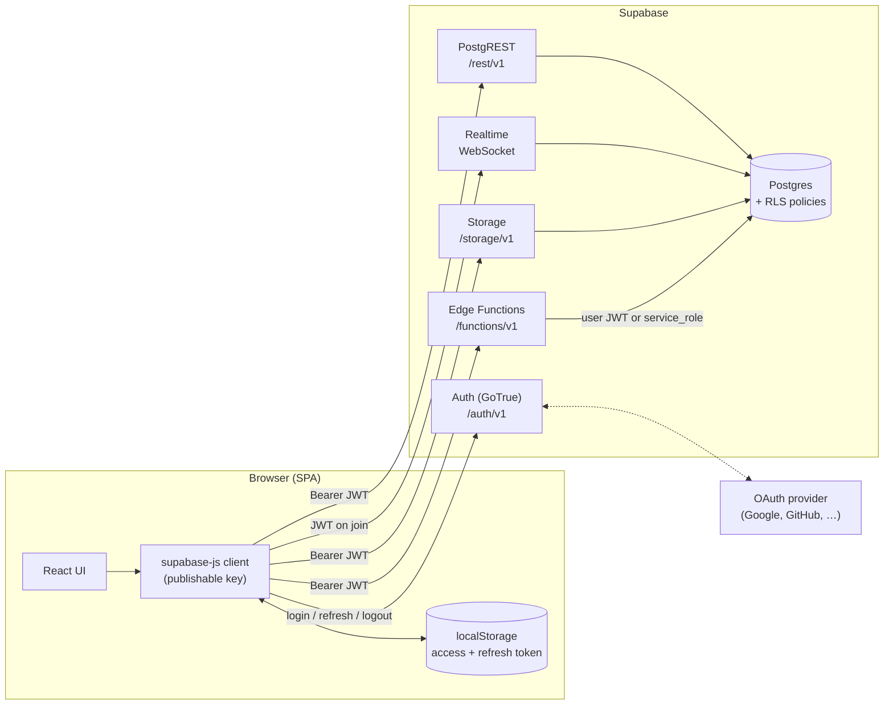
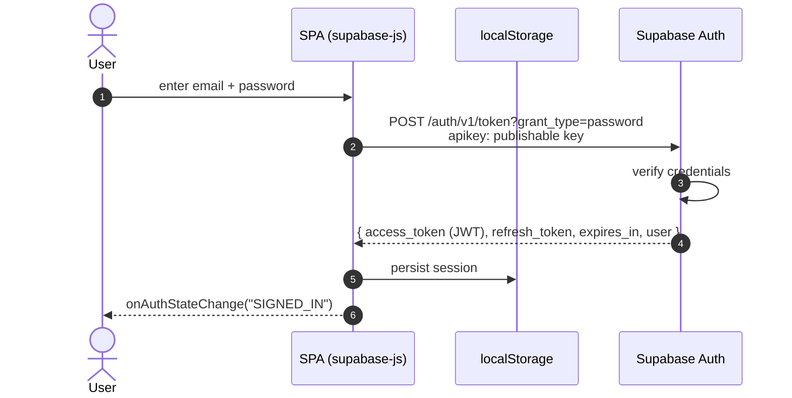
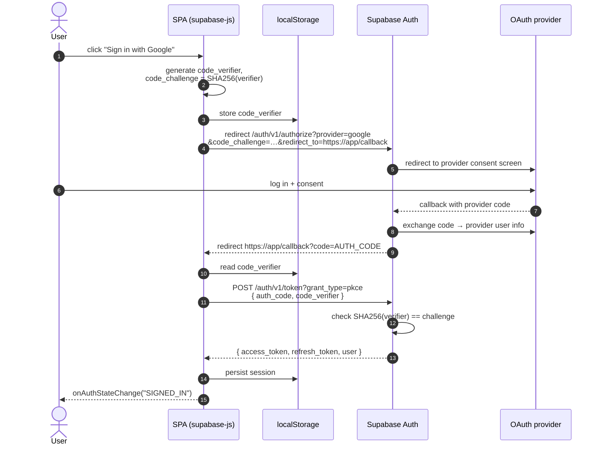
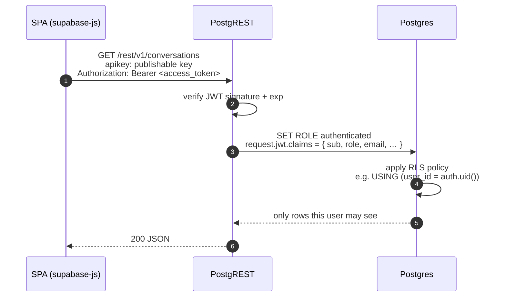
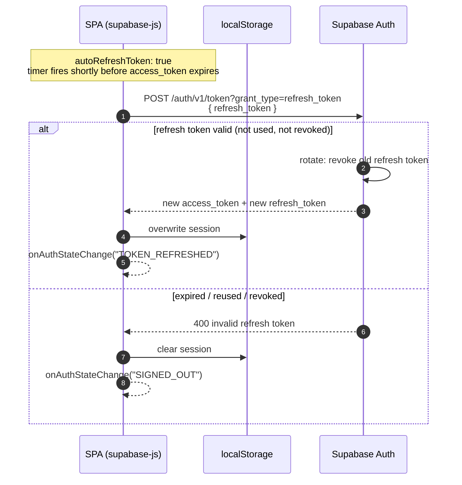
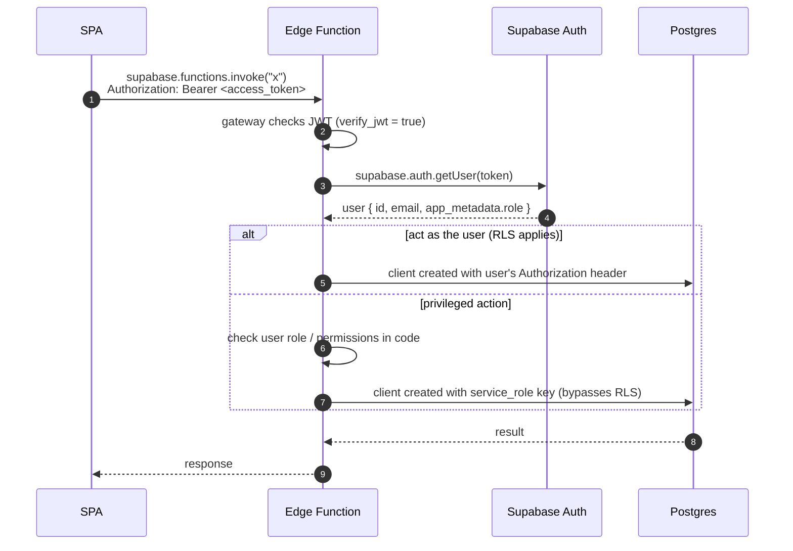
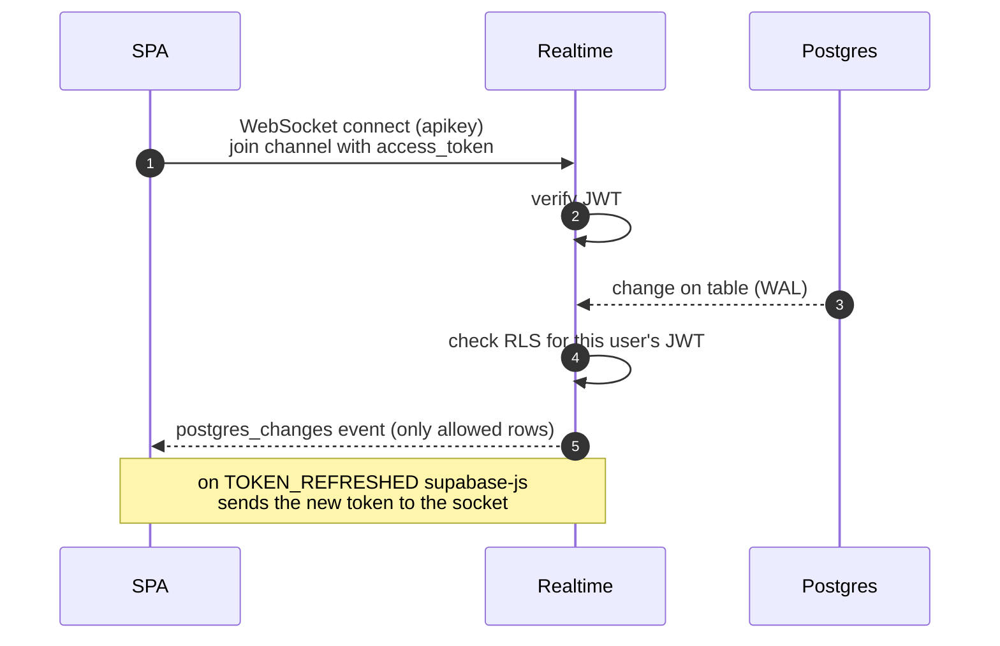
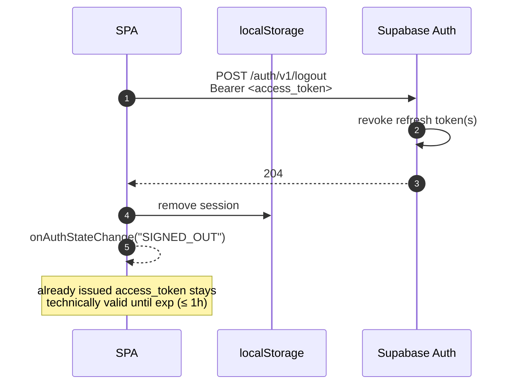
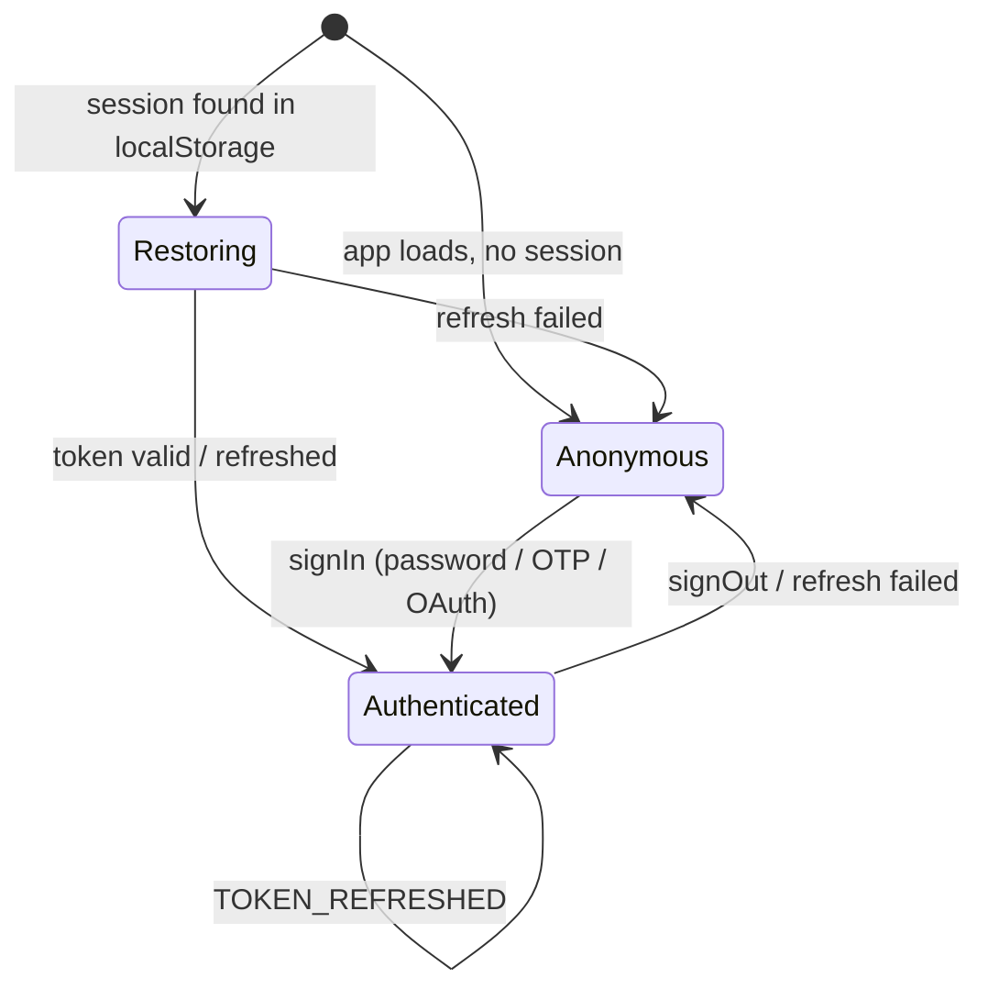

# Supabase Auth in a SPA

How authentication and authorization work when a browser-only app (React/Vite SPA,
no backend of its own) talks to Supabase with `@supabase/supabase-js`.

Key ideas:

- The SPA only ever holds the **publishable (anon) key** — it is public and grants nothing by itself.
- After login the user gets a **JWT access token** (short-lived, ~1h) + a **refresh token** (long-lived, single-use).
- Every request to Supabase carries the access token; **Postgres RLS policies** decide what that user may read/write (`auth.uid()`, `auth.jwt()`).
- The **secret / service_role key never goes into the SPA** — it bypasses RLS.

---

## 1. Components



---

## 2. Sign in (email + password)



Magic link / OTP work the same way, except step 2–3 are split: Auth emails a code or link,
and the token is issued when the user confirms it.

---

## 3. Sign in with OAuth (PKCE flow — default for SPAs)



`redirect_to` must be listed in **Auth → URL Configuration → Redirect URLs**.

---

## 4. Authorized data request + RLS



Without a session the same request runs as role **`anon`** — only policies granted to `anon` apply.

Example policy:

```sql
alter table conversations enable row level security;

create policy "own rows"
on conversations for select
to authenticated
using (user_id = auth.uid());
```

---

## 5. Token refresh



On page reload supabase-js reads the session from localStorage, and refreshes it immediately if the access token is already expired.

---

## 6. Edge Function call



---

## 7. Realtime subscription



---

## 8. Sign out



---

## 9. Session lifecycle (state view)



---

## Client setup for a SPA with login

```ts
import { createClient } from '@supabase/supabase-js'

export const supabase = createClient(
  import.meta.env.VITE_SUPABASE_URL,
  import.meta.env.VITE_SUPABASE_PUBLISHABLE_KEY,
  {
    auth: {
      flowType: 'pkce',        // OAuth / magic link via code exchange
      persistSession: true,    // keep session in localStorage
      autoRefreshToken: true,  // refresh before expiry
      detectSessionInUrl: true // handle ?code= on the callback route
    },
  },
)

supabase.auth.onAuthStateChange((event, session) => {
  // SIGNED_IN | TOKEN_REFRESHED | SIGNED_OUT | USER_UPDATED | PASSWORD_RECOVERY
})
```

> Note: the current `admin/src/api/supabase.ts` uses `persistSession: false, autoRefreshToken: false`
> because the admin panel has no user login yet (Realtime only). Switch to the settings above when adding auth.

## Security checklist

- RLS **enabled on every table** exposed through the API.
- Only the publishable key in the SPA bundle; `service_role` / secret key only in Edge Functions.
- Role checks (admin, etc.) via `app_metadata` (users can't edit it), not `user_metadata`.
- Redirect URLs allow-listed in the dashboard.
- localStorage is readable by any script on the page → keep XSS surface small (CSP, no untrusted HTML).
